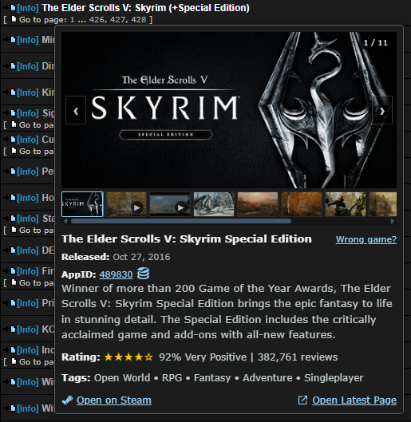

#  CS.RIN.RU Steam Hover Preview

A userscript that displays Steam game information when hovering over game topic titles on CS.RIN.RU. Get Steam media, ratings, tags, AppID tools, SteamDB links, and latest-thread actions without leaving the forum list.

  

## Wiki and Code Review

Version **4.11** keeps the game chooser open while you move to it. The [project wiki](docs/wiki/Home.md) covers behavior and architecture. See the [release checklist](RELEASE_CHECKLIST.md) and [Greasy Fork Markdown notes](GREASYFORK_CHANGELOG.md).

## Features

- **Steam Media Carousel** - Steam header image first, with screenshots and click-to-play videos when available
- **Thumbnail Strip** - Quickly jump between available Steam media without leaving the hover card
- **Theatre Mode** - Open screenshots and trailers in a larger Steam-style media viewer with navigation, video controls, and fullscreen support
- **Theatre Footer Actions** - Open the Steam page or the CS.RIN.RU topic's latest page directly from theatre mode
- **Description** - Short game description from Steam
- **Steam Reviews** - Plain Rating row with stars, positive percentage, Steam category and actual review count, plus distinct zero/error states
- **Actual Steam Tags First** - Real Steam tags in the first meaningful preview, with no genre substitution
- **Release Date** - Game release information
- **AppID Utility** - Click the Steam AppID to copy it, or use the compact external link to open SteamDB
- **CS.RIN Thread Tags** - Shows bracketed topic tags in the hover card with OG CS.RIN.RU Enhanced-style colors
- **Open on Steam** - Direct link to the Steam store page from the hover card and theatre footer
- **Open Latest Page** - Opens the latest page of the CS.RIN.RU topic, where new links and updates are usually posted
- **Topic Cleanup** - Cleans forum title tags like `[Info]`, `[CRACKED]`, `[NOT CRACKED]`, build/update labels, and platform notes before searching Steam
- **Base Game Matching** - Prefers base-game Steam results over DLC, upgrades, season passes, and store extras
- **Field-Level Caching** - Persistent AppID data, independently refreshed tags/reviews, saved match corrections, and safe cross-tab merging
- **Tags-First Preloading** - Configurable nearby/full-page warming, including bounded background-tab loading

## Installation

1. Install a userscript manager:
   - [Tampermonkey](https://www.tampermonkey.net/) (Recommended)
   - [Violentmonkey](https://violentmonkey.github.io/)
   - [Greasemonkey](https://www.greasespot.net/)

2. Install the script:
   - **[Install from Greasy Fork](https://greasyfork.org/en/scripts/580613-cs-rin-ru-steam-hover-preview)** (Recommended)
   - Or copy `csrinruSteamHoverPreview.user.js` manually from this repo

## Supported Sites

The script works on CS.RIN.RU forum pages:

- `cs.rin.ru/forum/*`
- `*.cs.rin.ru/forum/*`

## How It Works

1. Navigate to a CS.RIN.RU forum topic list
2. Hover over a game topic title in the `Topics` section
3. The script extracts and cleans the game name from the topic title
4. Searches Steam for a matching base game
5. Displays a tooltip with Steam information and browsable media when available
6. Copy the AppID, open SteamDB, open theatre mode, or use `Open on Steam` / `Open Latest Page`

## Technical Details

- **Data**: Official keyless Steam review API, single-AppID storefront details/search, and Steam store-page tag parsing. No SteamDB scraping.
- **Matching**: General title/format/typo comparison, validated app types and DLC parents, source-content Steam-link recovery, and persistent per-listing corrections.
- **Cache**: Details/tags fresh for 24 hours; review freshness is 15 minutes for new/unknown/upcoming releases and 3 hours otherwise. Usable stale tags refresh in the background.
- **Preload**: Nearby rows by default; Entire page and On hover only available in the userscript menu. Runnable hidden tabs warm serially; sleeping/discarded/closed tabs cannot run it.
- **Development**: Shared source, reproducible standalone builds, dependency locks, lint/format, unit/browser tests, and CI. See [CONTRIBUTING](CONTRIBUTING.md).
- **Action icons**: Bundled SVGs; see [third-party notices](THIRD_PARTY_NOTICES.md).

## License

MIT License - see [LICENSE](LICENSE) for details.

## Author

**DeonHolo**

- [Greasy Fork Profile](https://greasyfork.org/en/users/1340389-deonholo)
- [GitHub](https://github.com/DeonHolo)
